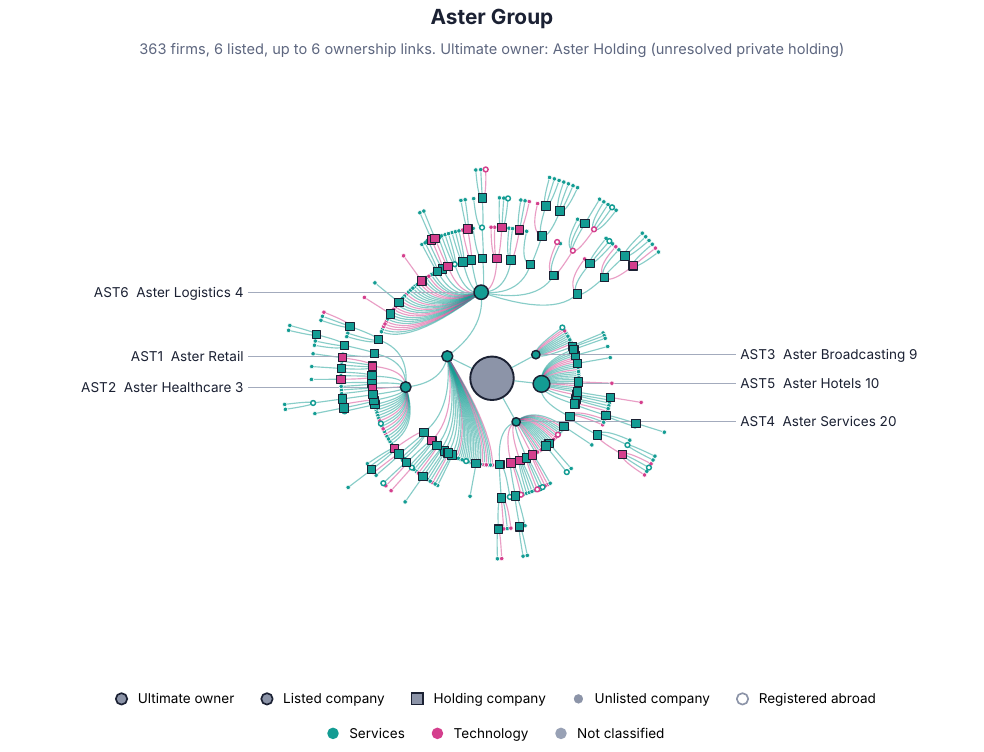

# Thai Business Groups (tbg)

An open, reproducible pipeline that maps the ownership and control network of Thailand's business groups from public disclosures: SET shareholder registers, Form 56-1 One Reports, DBD shareholder lists (BOJ.5), bank Pillar 3 reports and GLEIF. It traces every subsidiary to its ultimate owner, measures pyramids and the gap between control and cash-flow rights, links bank groups to business groups, and produces publication-ready figures, an interactive explorer and an arXiv-style paper whose numbers are filled in automatically.


*Everything in `docs/` is built from synthetic data: every company, person and number there is fictional.*

## Features

- **Collection and extraction.** Downloaders for public sources and LLM-assisted table extraction from PDF reports (Claude API, with batch mode), with review queues for every uncertain step.
- **Entity resolution.** Thai and English names, repair of Thai PDF glyph artefacts, legal forms and personal titles, conservative fuzzy matching.
- **Ultimate ownership.** Cash-flow rights as M(I−M)⁻¹ and block-wise weakest-link control rights (La Porta et al. 1999; Claessens et al. 2000), with cross-holdings and cycles, family aggregation, and Thai NVDR, custodian and fund accounts excluded from control.
- **Finance–business nexus.** Ownership, shared directors and fund holdings between bank groups and business groups.
- **Outputs.** Poster-size network maps, group control trees, charts checked automatically for overlapping text, a self-contained HTML explorer ([docs/explorer.html](docs/explorer.html)) and a LaTeX paper ([docs/paper_demo.pdf](docs/paper_demo.pdf)) compiled with pdfLaTeX, with an arXiv-ready bundle.



## Quick start

```bash
pip install -r requirements.txt
python -m pytest -q        # unit tests of the ownership algorithms
python -m tbg demo         # synthetic end-to-end run: demo/figures, demo/explorer, demo/paper/paper.pdf
python -m tbg init         # then collect real data into work/ (step-by-step guide below, in Thai)
```

Compiling the paper needs LaTeX (TeX Live or MiKTeX). Table extraction needs the `ANTHROPIC_API_KEY` environment variable.

## Repository layout

| Path | Content |
|---|---|
| `tbg/` | Pipeline: collection, extraction, entity resolution, ownership and control, groups, figures, explorer, paper |
| `prompts/` | Master research prompt and extraction prompts |
| `seeds/` | Labels for known groups (labels only; membership comes from the data) |
| `paper/` | LaTeX source and bibliography of the paper |
| `templates/` | Template of the interactive explorer |
| `tests/` | Unit tests |
| `docs/` | Synthetic demonstration outputs |
| `config.yaml` | All settings: project, thresholds, model, paths |

## Data and ethics

This repository holds code and synthetic examples only. Real data go to `work/`, which is git-ignored: shareholder and director lists contain personal data protected by Thailand's Personal Data Protection Act, so do not commit them. Read each website's terms of use before collecting data, and verify every reference in `paper/references.bib` against the original before citing it.

## Citation and license

Cite this software with the metadata in `CITATION.cff` (GitHub's "Cite this repository" button). Released under the MIT License, see `LICENSE`.

---

## คู่มือภาษาไทย

ชุดเครื่องมือสำหรับสร้างฐานข้อมูลการถือหุ้นของบริษัทจดทะเบียนไทยและบริษัทลูกทุกชั้นจากข้อมูลสาธารณะ เพื่อตอบว่าใครคุมบริษัทไหน ผ่านกี่ชั้น และธนาคารเชื่อมกับเครือธุรกิจอย่างไร ผลลัพธ์ที่ได้มีภาพ network ระดับโปสเตอร์, ตัวสำรวจแบบ interactive และ paper.pdf ที่ตัวเลขทุกตัวเติมอัตโนมัติจากผลวิเคราะห์

> **ไฟล์ใน `demo/` ทำจากข้อมูลจำลองทั้งหมด** ชื่อบริษัท บุคคล และตัวเลขเป็นของสมมติ ใช้ดูหน้าตาผลลัพธ์และทดสอบระบบเท่านั้น ห้ามอ้างอิงเป็นข้อเท็จจริง

### 0. ติดตั้ง

```bash
python -m venv .venv && source .venv/bin/activate      # Windows: .venv\Scripts\activate
pip install -r requirements.txt
python -m pytest -q                                      # ทดสอบอัลกอริทึม ควรผ่านทั้งหมด
```

ถ้าจะคอมไพล์ paper.pdf ในเครื่อง ต้องมี LaTeX (TeX Live หรือ MiKTeX) หรืออัปโหลดโฟลเดอร์ `work/paper/` ขึ้น Overleaf แล้วตั้ง compiler เป็น pdfLaTeX (หรือ XeLaTeX ถ้ามีชื่อภาษาไทย) ส่วนการสกัดตารางจาก PDF ต้องมี Anthropic API key:

```bash
export ANTHROPIC_API_KEY=...        # Windows PowerShell: $env:ANTHROPIC_API_KEY="..."
```

### 1. ลองรันตัวอย่างก่อน (ราว 5 นาที)

```bash
python -m tbg demo
```

จะได้ `demo/figures/` (ภาพ galaxy โปสเตอร์และภาพ tree รายเครือ), `demo/explorer/index.html` (เปิดด้วย browser ได้เลย) และ `demo/paper/paper.pdf`

### 2. เก็บข้อมูลจริงทีละชั้น

ข้อมูลจริงทั้งหมดอยู่ในโฟลเดอร์ `work/` (ตั้งค่าได้ใน `config.yaml`) เริ่มด้วย

```bash
python -m tbg init       # สร้างโฟลเดอร์และไฟล์ CSV เปล่าที่มีหัวคอลัมน์ถูกต้อง
python -m tbg status     # ดูความครอบคลุมได้ทุกเมื่อ
```

| ขั้น | ข้อมูล | วิธีที่แนะนำ | ไฟล์ปลายทาง |
|---|---|---|---|
| 2.1 | รายชื่อบริษัทจดทะเบียน (SET + mai) | `python -m tbg collect set-universe` ถ้าดาวน์โหลดไม่ได้ ให้โหลด Excel จากเว็บ SET เอง แล้วเติม market cap จาก SETSMART | `data/raw/universe/` |
| 2.2 | ผู้ถือหุ้นใหญ่ 10 รายแรก | ทางที่ดีที่สุดคือ export จาก SETSMART (ห้องสมุดมหาวิทยาลัยหลายแห่งมีสิทธิ์ใช้) หรือคีย์จากหน้าเว็บ SET ลงไฟล์เทมเพลต ส่วนคำสั่ง `collect set-shareholders` เป็นแบบทดลองและอาจถูกเว็บปฏิเสธ | `data/raw/shareholders/` |
| 2.3 | 56-1 One Report (PDF) | ใส่ URL ของแต่ละบริษัทใน `data/manual/document_urls.csv` แล้วรัน `collect documents` หรือดาวน์โหลดเองแล้วตั้งชื่อเป็น `TICKER_ปี_ภาษา.pdf` เช่น `CPALL_2025_en.pdf` | `data/raw/documents/one_report/` |
| 2.4 | บอจ.5 ของบริษัทโฮลดิ้งเอกชน | ขอคัดสำเนาจาก DBD (มีค่าธรรมเนียม) โดยเรียงตาม `review/dbd_priority_queue.csv` ซึ่งจัดอันดับว่าบริษัทไหนคุมบริษัทมากที่สุดแต่ยังไม่รู้ผู้ถือหุ้น | `data/raw/documents/boj5/` |
| 2.5 | Pillar 3 ของธนาคาร | ดาวน์โหลดจากเว็บธนาคาร ตั้งชื่อ `TICKER_ปี.pdf` | `data/raw/documents/pillar3/` |
| 2.6 | ใบอนุญาตสถาบันการเงิน | คัดจากรายชื่อของ ธปท. ก.ล.ต. คปภ. ลง `fi_licenses.csv` | `data/raw/fi/` |
| 2.7 | GLEIF (ฟรี มี API) | `python -m tbg collect gleif` | `data/raw/gleif/` |

ไฟล์ CSV ทุกไฟล์ในโฟลเดอร์เดียวกันจะถูกอ่านรวมกัน จึงเพิ่มไฟล์ที่คีย์เองได้ตลอด (เช่น `manual_2.csv`)

### 3. สกัดตารางจาก PDF ด้วย Claude

```bash
python -m tbg extract pages --kind subsidiaries          # หาหน้าที่มีตาราง ไม่เสียค่า API
python -m tbg extract run   --kind subsidiaries --dry-run --limit 3   # ดูว่าจะส่งอะไร
python -m tbg extract run   --kind subsidiaries --limit 3             # ลองจริง 3 ฉบับ แล้วตรวจผล
python -m tbg extract run   --kind subsidiaries --batch               # ทั้งหมดแบบ batch (ราคาถูกกว่า)
python -m tbg extract collect-batch --kind subsidiaries               # ดึงผลเมื่อ batch เสร็จ
```

`--kind` มี `subsidiaries`, `shareholders`, `directors` (ใช้ One Report), `pillar3` และ `boj5` ถ้าการเลือกหน้าผิด ให้แก้คอลัมน์ `pages` ใน `data/interim/pages_<kind>.csv` เองได้ Prompt ที่ใช้อยู่ใน `prompts/extract_*.md` แก้ได้ตามต้องการ ผลที่ความมั่นใจต่ำกว่า 0.8 จะถูกส่งไป `review/llm_<kind>_check.csv` ให้ตรวจด้วยมือ ควรตรวจเพิ่มอีกราว 5% ของรายงานแบบสุ่มเพื่อรายงานอัตราความผิดพลาดใน paper ชื่อรุ่นโมเดลตั้งใน `config.yaml` (ตรวจชื่อและราคาล่าสุดที่ docs.claude.com)

### 4. สร้างเครือข่าย วิเคราะห์ และตรวจทาน

```bash
python -m tbg build      # รวมทุกแหล่ง จับคู่ชื่อ เขียน data/processed/
python -m tbg analyze    # เจ้าของสูงสุด เครือ พีระมิด ความเชื่อมโยงกับธนาคาร
```

หลังรันทุกครั้ง ให้ดูไฟล์ใน `review/`:

- `entity_resolution_candidates.csv` ชื่อที่คล้ายกันแต่ระบบไม่กล้ารวม ถ้าเป็นบริษัทเดียวกัน ให้เพิ่มแถวใน `data/manual/entity_overrides.csv` (alias → canonical)
- `holder_types.csv` ตรวจว่าระบบจัดประเภทผู้ถือหุ้นถูกไหม (บุคคล, กองทุน, custodian, รัฐ)
- `holdings_issues.csv` บริษัทที่ผลรวมการถือหุ้นเกิน 100% มักเกิดจากชื่อซ้ำหรือสกัดผิด
- `seed_check.csv` ticker ที่คาดว่าเป็นเครือเดียวกันแต่ข้อมูลแยกเป็นคนละเครือ
- `validation_sample.csv` 100 บริษัทสุ่มไว้ให้ตรวจด้วยมือ กรอก `is_correct` (yes/no) แล้วความแม่นยำจะไปขึ้นใน paper อัตโนมัติ
- `data/manual/family_map.csv` กำหนดว่าใครอยู่ครอบครัวไหน ใช้แทนการรวมด้วยนามสกุล ควรทำมือสำหรับ 50 เครือแรก

ทำวนแบบนี้ไปเรื่อย ๆ (เพิ่ม บอจ.5 → build → analyze → ตรวจ) จนสัดส่วน "unresolved private holding" ต่ำพอ

### 5. ภาพ ตัวสำรวจ และ paper

```bash
python -m tbg figures    # ภาพทั้งหมด (ราว 3 นาที)
python -m tbg explorer   # work/explorer/index.html
python -m tbg paper      # work/paper/paper.pdf
python -m tbg all        # build → analyze → figures → explorer → paper
```

รูปทุกรูปที่ใช้ใน paper วาดที่ขนาดพิมพ์จริง (กว้าง 6.5 นิ้ว) และถูกตรวจอัตโนมัติว่าไม่มีตัวหนังสือทับกัน ผลอยู่ที่ `results/figure_qa.csv`

แก้เนื้อหา paper ที่ `paper/paper.tex` (ไม่ใช่สำเนาใน work/ ซึ่งถูกเขียนทับทุกครั้ง) ตัวเลขในเนื้อหาใช้ macro เช่น `\ShareFamilyTwenty` จึงอัปเดตเองเมื่อข้อมูลเปลี่ยน ชื่อเรื่อง ผู้แต่ง สังกัด อีเมล และ keywords ตั้งใน `config.yaml` (หัวข้อ `project`)

**รูปแบบ arXiv:** paper ใช้หน้าตาแบบ arXiv preprint และคอมไพล์ด้วย pdfLaTeX เป็นค่าเริ่มต้น หลังคอมไพล์จะได้ `work/paper/arxiv_submission.zip` (paper.tex, paper.bbl, ตาราง และรูป) ซึ่งอัปโหลดขึ้น arXiv ได้ทั้งไฟล์ ถ้ามีชื่อภาษาไทยในตาราง ระบบจะสลับไปใช้ XeLaTeX ให้เอง แต่เท่าที่ทราบ arXiv ยังไม่รองรับ XeLaTeX จึงควรเปลี่ยนชื่อเหล่านั้นเป็นอักษรโรมันก่อนส่ง และควรตรวจข้อกำหนดล่าสุดในหน้า submission help ของ arXiv

### 6. ใช้ Master prompt

`prompts/00_master_research_prompt.md` คือ prompt หลักสำหรับคุมงานวิจัยทั้งโครงการกับ Claude แบ่งเป็น 8 phase ตั้งแต่วางขอบเขตจนตรวจก่อนส่ง วิธีใช้อยู่ต้นไฟล์

### 7. ข้อควรระวัง

- **เอกสารอ้างอิง** ใน `paper/references.bib` และในเนื้อหาต้องตรวจกับต้นฉบับทุกรายการก่อนส่ง
- **รายชื่อเครือ** ใน `seeds/business_groups.yaml` ใช้แค่ตั้งชื่อ ต้องตรวจ ticker กับ SET ก่อน โครงสร้างเปลี่ยนบ่อย
- **ข้อมูลส่วนบุคคล** ชื่อกรรมการและผู้ถือหุ้นที่เป็นบุคคลอยู่ภายใต้ PDPA ใช้เพื่อการวิจัยได้เมื่อมีมาตรการคุ้มครองที่เหมาะสม ควรผ่านคณะกรรมการจริยธรรมการวิจัย และไม่เผยแพร่ข้อมูลรายบุคคลเกินจำเป็น (นี่ไม่ใช่คำแนะนำทางกฎหมาย)
- **การดึงข้อมูลจากเว็บ** อ่านเงื่อนไขการใช้งานของแต่ละเว็บก่อน ตั้ง `user_agent` ให้มีอีเมลของคุณ และอย่าลด `delay_seconds`
- **ข้อจำกัดที่ต้องเขียนใน paper** สายการถือหุ้นที่ออกนอกประเทศจะขาด, nominee มองไม่เห็นจากทะเบียน, การรวมครอบครัวด้วยนามสกุลอาจผิด และข้อมูลแต่ละแหล่งมีวันที่ต่างกัน

### โครงสร้างไฟล์

```
tbg/            โค้ด (build, ownership, groups, fi, analyze, viz*, explorer, paper, collect, extract)
prompts/        master prompt + prompt สกัดข้อมูล
seeds/          รายชื่อเครือสำหรับตั้งชื่อ
paper/          paper.tex + references.bib (ต้นฉบับที่แก้ได้)
templates/      แม่แบบ explorer.html
tests/          unit tests ของอัลกอริทึม
config.yaml     การตั้งค่าทั้งหมด
docs/           ตัวอย่างผลลัพธ์จากข้อมูลจำลอง (ภาพ, paper, explorer)
demo/, work/    สร้างขึ้นตอนรัน ไม่ถูกเก็บใน git (ดู .gitignore)
```
