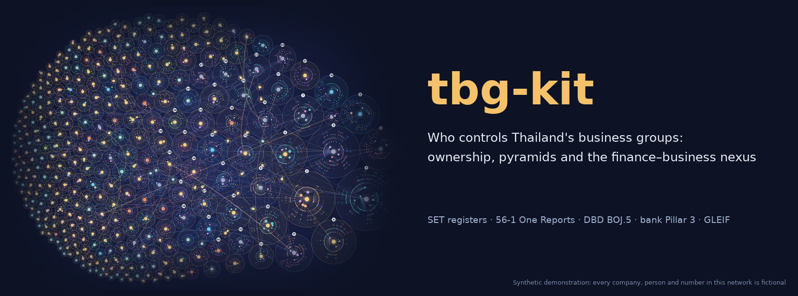

<p align="center"><a href="https://thanatchon36.github.io/tbg-kit/explorer.html"></a></p>

<p align="center">
<a href="https://github.com/thanatchon36/tbg-kit/actions/workflows/ci.yml"></a>
<a href="pyproject.toml"></a>
<a href="https://thanatchon36.github.io/tbg-kit/explorer.html"></a>
<a href="docs/paper_demo.pdf"></a>
<a href="docs/data_sources.md"></a>
<a href="LICENSE"></a>
</p>

<p align="center">
🕸️ <b><a href="https://thanatchon36.github.io/tbg-kit/explorer.html">Explore the network online</a></b> ·
📄 <b><a href="docs/paper_demo.pdf">Paper (demo PDF)</a></b> ·
🗂️ <b><a href="docs/data_sources.md">Data sources</a></b> ·
🇹🇭 <b><a href="docs/guide_th.md">คู่มือภาษาไทย</a></b> ·
🧭 <b><a href="prompts/00_master_research_prompt.md">Master prompt</a></b>
</p>

**Who controls Thailand's business groups, through how many layers, and how are they tied to the banks?** An open,
reproducible pipeline that maps the ownership and control network of Thai business groups from public disclosures:
SET shareholder registers, Form 56-1 One Reports, DBD shareholder lists (BOJ.5), bank Pillar 3 reports and GLEIF. It
traces every subsidiary to its ultimate owner, measures pyramids and the gap between control and cash-flow rights,
links bank groups to business groups, and produces publication-ready figures, an interactive explorer and an
arXiv-style paper whose numbers are filled in automatically.


> **Synthetic data notice.** This repository holds code and synthetic examples only. Every company, person and
> number in `docs/` and `demo/` is fictional and says nothing about real Thai firms. Real data go to `work/`, which
> is git-ignored: shareholder and director lists contain personal data protected by Thailand's Personal Data
> Protection Act (PDPA). `docs/data_sources.md` is the list of real sources; collect them and run `make all`.

## Install and quickstart

```bash
make setup      # uv venv + dependencies (Python 3.12)
make test       # unit tests of the ownership algorithms
make demo       # synthetic end-to-end run -> demo/figures, demo/explorer, demo/paper/paper.pdf  (about 5 minutes)
make init       # then collect real data into work/ (docs/data_sources.md, docs/guide_th.md)
```

Without `make` or `uv`: `pip install -e ".[dev]"`, then `python -m tbg <command>` (or the `tbg` script). Compiling
the paper needs LaTeX (TeX Live or MiKTeX). Table extraction needs the `ANTHROPIC_API_KEY` environment variable.

Outputs: `work/data/processed/` (entities, holdings, links), `work/results/` (ultimate owners, groups, metrics,
figure QA), `work/review/` (queues for manual checks), `work/figures/`, `work/explorer/index.html`
(self-contained) and `work/paper/paper.pdf` with `work/paper/arxiv_submission.zip`.

| Target | Purpose |
|---|---|
| `demo` | Synthetic end-to-end run into `demo/`. Never a substitute for real data |
| `init` | Create `work/` with folders and blank CSV templates |
| `status` | Coverage report and review queues |
| `build` | Merge all sources, resolve entity names, write `data/processed/` |
| `analyze` | Ultimate ownership, business groups, pyramids, finance–business nexus |
| `figures` | Poster network map, group control trees, paper figures with text-overlap QA |
| `explorer` | Self-contained interactive explorer → `work/explorer/index.html` |
| `paper` | LaTeX tables and macros, compile `work/paper/paper.pdf` and the arXiv bundle |
| `all` | `build` → `analyze` → `figures` → `explorer` → `paper` |
| `smoke` | Synthetic `build` + `analyze` in `ci-demo/` (what CI runs) |
| `docs` | Refresh the synthetic showcase in `docs/` from a fresh `demo` |

Collection and extraction take arguments, so they are run directly:
`python -m tbg collect {set-universe,set-shareholders,documents,gleif}` and
`python -m tbg extract {pages,run,collect-batch} --kind {subsidiaries,shareholders,directors,pillar3,boj5}`.

## What the pipeline does

1. **Collection** (`tbg.collect`): downloaders for the SET universe, top-10 shareholders, One Report PDFs and GLEIF,
   plus CSV templates for SETSMART exports and manual entry. Every CSV in a source folder is read.
2. **Extraction** (`tbg.extract`, `prompts/extract_*.md`): finds the pages that hold subsidiary, shareholder, director,
   Pillar 3 and BOJ.5 tables, and extracts them with the Claude API (Message Batches mode available). Rows with
   confidence below 0.8 go to a review queue.
3. **Entity resolution** (`tbg.names`, `tbg.resolve`, `tbg.classify`): Thai and English names, repair of Thai PDF
   glyph artefacts, legal forms and personal titles, conservative fuzzy matching with a review file and manual
   overrides; holder types (person, family, fund, custodian, NVDR, state, foreign).
4. **Ultimate ownership** (`tbg.ownership`): cash-flow rights as M(I−M)⁻¹ and block-wise weakest-link control rights
   (La Porta et al. 1999; Claessens et al. 2000), with cross-holdings and cycles, family aggregation, and Thai NVDR,
   custodian and fund accounts excluded from control.
5. **Groups and the finance–business nexus** (`tbg.groups`, `tbg.fi`, `tbg.analyze`): business groups around each
   ultimate owner, pyramids and control–cash-flow wedges, and the ownership, shared-director and fund-holding links
   between bank groups and business groups. `review/dbd_priority_queue.csv` ranks which BOJ.5 documents to buy next.
6. **Deliverables** (`tbg.viz*`, `tbg.explorer`, `tbg.paper`): poster-size network maps and control trees drawn at
   print size and checked for overlapping text, the HTML explorer, and the LaTeX paper in which every number is a
   macro filled from the results.

## Research: *Mapping Thailand's Business Groups: Ownership, Control, and the Finance-Business Nexus*

The working paper by Thanatchon Chongmankhong is in [`paper/`](paper/): the LaTeX source
[`paper/paper.tex`](paper/paper.tex) and its bibliography [`paper/references.bib`](paper/references.bib). `make paper`
fills its tables and in-text numbers (macros such as `\ShareFamilyTwenty`) from the results, compiles it with
pdfLaTeX in arXiv preprint layout (XeLaTeX when tables contain Thai names) and packs `arxiv_submission.zip`. A build
from synthetic data is in [`docs/paper_demo.pdf`](docs/paper_demo.pdf); `make all` on the real data replaces every
number in it.

- Interactive explorer (synthetic): [online](https://thanatchon36.github.io/tbg-kit/explorer.html) ·
  [`docs/explorer.html`](docs/explorer.html)
- Research workflow with Claude in 8 phases, from scoping to pre-submission checks:
  [`prompts/00_master_research_prompt.md`](prompts/00_master_research_prompt.md)

<p align="center"></p>

## Repository layout

```
config.yaml                 all settings: project, workspace, thresholds, model, paths
src/tbg/
  config.py                 defaults, YAML overrides, workspace paths
  collect.py, extract.py    downloaders; page finder + Claude table extraction
  names.py, resolve.py      name normalisation, Thai glyph repair, entity resolution
  classify.py               holder types
  build.py                  raw -> processed tables
  ownership.py              cash-flow and control rights, cycles
  groups.py, fi.py          business groups; financial institutions and the nexus
  analyze.py, status.py     metrics and review queues; init and coverage report
  viz.py, viz_galaxy.py, viz_layout.py   figures with overlap QA
  explorer.py, paper.py     HTML explorer; LaTeX macros, tables, compile, arXiv bundle
  synthetic.py              synthetic world for demo and CI
  __main__.py               python -m tbg {demo,synth,init,status,collect,extract,build,analyze,figures,explorer,paper,all}
prompts/                    master research prompt and extraction prompts
seeds/business_groups.yaml  labels for known groups (labels only; membership comes from the data)
paper/                      paper.tex, references.bib
templates/explorer.html     explorer template
scripts/make_banner.py      README banner from the galaxy map
docs/                       synthetic showcase (images, explorer, paper), data sources, Thai guide, GitHub Pages
tests/                      ownership algorithms
```

## Going from synthetic to real

1. `make init`, then collect the files in [`docs/data_sources.md`](docs/data_sources.md) into `work/` (any subset
   works; `make status` shows coverage).
2. Extract the PDF tables with `python -m tbg extract ...`; check the low-confidence rows in `work/review/` and a
   random 5% of reports by hand to report an error rate.
3. `make build analyze`, then work through `work/review/` (entity-resolution candidates, holder types, totals above
   100%, seed check, the validation sample) and `data/manual/family_map.csv` for the largest groups.
4. Buy the BOJ.5 documents at the top of `review/dbd_priority_queue.csv` and repeat until the share of unresolved
   private holdings is low enough.
5. `make all`. The step-by-step version, in Thai, is [`docs/guide_th.md`](docs/guide_th.md).

## Limitations
Ownership chains that leave Thailand are cut; nominees are invisible in registers; family aggregation by surname can
be wrong; sources have different dates. Verify every reference in `paper/references.bib` and every ticker in
`seeds/business_groups.yaml` before citing. Personal data fall under the PDPA: get ethics approval and do not publish
individual-level data beyond what is needed (this is not legal advice). Read each website's terms of use before
collecting data.

## Citation
See [`CITATION.cff`](CITATION.cff) (GitHub's "Cite this repository" button) and [`CHANGELOG.md`](CHANGELOG.md).
License: MIT.
